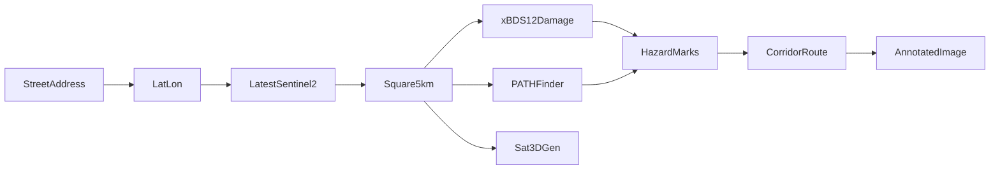

# Latest satellite view of a road, with a safety drawing

The goal is to help a relief worker or a refugee see the latest public satellite image of a specific street or highway in a place where people are not safe, including examples such as Ukraine and Iran, and to read a drawing on that image that points toward a safer way along that road. A military mode that finds forces, weapons, or fortifications is not part of this plan. This project does not train a model. It does not task a satellite. It only reads imagery that Copernicus already publishes.

The place is not hardcoded. The user types a street address. Examples are a numbered address on a highway outside Kharkiv or a street address in Tehran. The same page works for any address the geocoder can find.

## Product flow

This is the scope:

1. Login or register as needed. Built: `/`, `/login/`, `/register/`.
2. Open the main dashboard. Built: `/dashboard/`, and it requires a signed-in user.
3. Search a location. The address box is on the dashboard.
4. Get coordinates, and pick the right match when several places come back. Built. Run the site with `python manage.py runserver`.
5. Get the 5 km satellite image centered on those coordinates. Built: `/api/scene`.
6. Model 1 paints the roads in that image. The safe route is the connected road pixels that Model 2 has not marked as blocked, from the address to the edge of the square. Built: `/api/annotate`.
7. Model 2 marks risks and damaged areas in the same 5 km. Built: `/api/annotate`.
8. Model 3 builds a 3D mesh of the buildings in that image for visualization.

A route is drawn only after the risk marks exist, so Model 1 and Model 2 finish together before the line is called safe. Model 3 does not change the route. It is a viewing aid. The mesh is an estimate of visible shape, not a structural inspection.

If the geocoder cannot find the address, or no scene in the last 30 days is clear enough, the page says that in plain language and does not invent an image. A new address loads a new 5 km square. It does not stretch the previous picture.

## Image size

Every address uses the same size. The user does not pick a zoom.

The ground window is always a **5 km by 5 km** square centered on the geocoded point. That is about an hour's walk, and it is the largest square that still fits a 512-pixel screen at the satellite's real detail. Sentinel-2 samples the ground at 10 m, which makes the native clip **500 by 500** pixels. The page shows it at **512 by 512** pixels. A scale bar states that one original pixel is 10 m.

The ground size stays 5 km at every latitude. The degree span of the box changes with latitude so the east-west side does not stretch. That conversion stays inside the lookup. The user only sees the address, the coordinates, and the 512 pixel image.

A new address loads a new 5 km square centered on that new point. It does not stretch the previous picture past 5 km. Squares overlap when the two addresses are close.

The box around the point is built in degrees from that ground size. One degree of latitude is about 111,320 m. One degree of longitude is that distance times the cosine of the latitude. Half of 5 km is 2,500 m on each side of the point.

## Where the image comes from

- Nominatim converts the typed address into coordinates and a display name. The request uses a descriptive user agent. The image is the square around that point, not a whole city and not a military site list.
- The pixels come from Sentinel-2 Level-2A on the Microsoft Planetary Computer STAC API at `https://planetarycomputer.microsoft.com/api/stac/v1`, collection `sentinel-2-l2a`. The query asks for the newest scene over that square with cloud cover under a set limit. Sentinel-2 is free and covers land worldwide. A new pass is typically a few days apart, and cloud or smoke can hide the ground, so "latest" means the newest published clear scene, not a live camera. No pretrained model finds the escape route. The hazard marks come from the models below, and the route is a grid search across those marks.
- Commercial or restricted high-resolution tasking is not used.

At 10 meters, the drawing can show the road corridor, large areas of water, and large rubble or collapsed blocks. It cannot see a single pothole, a curb, or a place where a person might trip. Those three legend rows stay on the graphic and say "not visible at satellite resolution" instead of guessing. Depth Anything and the pothole phrases are not run on these scenes, because a straight-down 10 meter image has no ground-level depth.

## What the graphic shows

Layers, each with a legend entry:

- **Safe route.** A path along the visible road corridor that stays off large water and large rubble. If the corridor is fully blocked, the graphic says the road is not passable and does not draw a line through the block.
- **Water damage.** Large standing water or flooded pavement inside the corridor.
- **Structure damage.** Large collapsed buildings or rubble fields beside the road. The mark means "do not enter," not a measured engineering grade.
- **Trip hazards.** Shown as not visible at this resolution.
- **Car travel may not work.** Large debris, rubble, or water covering the roadway. A narrow pothole is not marked.
- **Next steps,** once the path reaches the far end of the clip: stay in the marked safer direction, do not re-enter buildings marked unsound, do not drive through marks that block cars, do not drink or drive through marked water, and ask local emergency services what to do next.

The scene date and the cloud note sit on the graphic so a relief worker can tell how old the picture is.

## Pretrained models

PyTorch only. Three published models, each run as released. There is no training script. None of them finds weapons, vehicles, or personnel.

- **Hazards.** [`prs-eth/xbd-s12_dmg_seed1`](https://huggingface.co/prs-eth/xbd-s12_dmg_seed1). It marks building damage on Sentinel imagery by comparing a before scene and the latest scene. Major and destroyed damage become structure-damage marks. Water and debris that cover the road come from that damage mask where it crosses the road. Potholes and trip hazards stay marked "not visible" at 10 m.
- **Roads for the way out.** [PATHFinder](https://github.com/Oraegbuayomide10/PathFinder), a pretrained road-segmentation model made for humanitarian road mapping. It paints which pixels are road. It does not emit an evacuation path. The drawn route is the connected road pixels that the hazard marks have not blocked, from the address pin to the edge of the square.
- **Building mesh.** [`qian43/Sat3DGen`](https://huggingface.co/qian43/Sat3DGen). From one overhead image it writes a 3D mesh of the scene, including building shapes. The mesh is an estimate of visible form, not a structural inspection and not a measured height. A 10 m Sentinel-2 pixel is coarser than the imagery this model was built for, so the mesh is a rough block model of the square, not a faithful model of one house.

## Data flow

## Runtime

`Dockerfile` installs PyTorch, transformers, Pillow, and rasterio, and a small web server. Weights download on first annotation. The page calls Planetary Computer and Nominatim over the network. There is no camera worker and no SpatiaLite database.

## Checks

- A known street address returns coordinates, a 5 km Sentinel-2 square, and that scene's capture date.
- The displayed image is 512 by 512 pixels and the scale bar reads 10 m per original pixel.
- An unknown address returns a clear not-found message and no image.
- Two geocoder matches require a confirmation before an image is loaded.
- A synthetic corridor image with a blue flood and a rubble block draws water damage, structure damage, and a route around both.
- The same synthetic image does not draw pothole or trip marks. Those legend rows say they are not visible.
- The phrase list used for satellite scenes does not include pothole, vehicles, weapons, personnel, or fortifications.
- The next-steps panel and the scene date are present on every successful output.

## Work status (Oct 23-29 Milestone)

- Done: homepage, login, register, and a dashboard whose address search confirms coordinates. Run it with `python manage.py runserver` at http://127.0.0.1:8000.
- Done: Show the confirmed point as a 5 km Sentinel-2 square at 512 by 512 pixels (`/api/scene`).
- Done: Clip that scene to the square around the geocoded point (`/api/clips`).
- Done: Draw water, large structure damage, car-blocking debris, the safe route, and the next-steps panel. State that potholes and trip hazards are not visible (`annotate.py`, `/api/annotate`, `/api/annotated-image`).
- Done: Point the Dockerfile at PyTorch, transformers, Pillow, and rasterio (`Dockerfile`).
- Done: Verify all checks via `python manage.py test`, `python test_annotate.py`, `python test_scene.py`, and `python test_geocode.py`.
