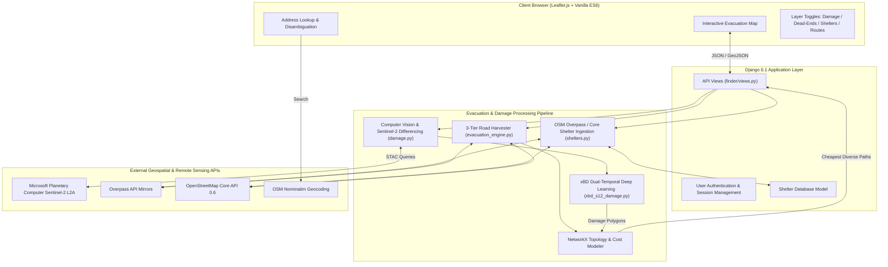

# 🛰️ Civilian Evacuation Assistant & Sentinel Disaster Routing Platform

[](https://www.python.org/)
[](https://www.djangoproject.com/)
[](https://leafletjs.com/)
[](https://www.openstreetmap.org/)
[](https://planetarycomputer.microsoft.com/)
[](LICENSE)

An open-source, humanitarian geospatial intelligence platform engineered to assist refugees, relief workers, and civilian emergency coordinators navigating active disaster and conflict zones. 

The platform synthesizes **real-time Sentinel-2 multispectral satellite imagery**, **deep-learning damage classification (xBD)**, **dynamic OpenStreetMap road network topologies**, and **diverse graph routing algorithms** to calculate the safest, hazard-aware evacuation paths to verified shelters.

---

## 📌 Table of Contents

- [Key Capabilities](#-key-capabilities)
- [System Architecture](#-system-architecture)
- [Routing & Analysis Engine](#-routing--analysis-engine)
  - [1. Resilient Road Network Harvesting](#1-resilient-road-network-harvesting)
  - [2. Reverse-Reachability & Stranded Node Detection](#2-reverse-reachability--stranded-node-detection)
  - [3. Spur & Cul-de-Sac Pruning](#3-spur--cul-de-sac-pruning)
  - [4. Diverse Multi-Path Generation (Yen's Algorithm + Diversity Filtering)](#4-diverse-multi-path-generation)
  - [5. Automated Shelter Discovery & Street Enrichment](#5-automated-shelter-discovery--street-enrichment)
- [Satellite Imagery & Damage Detection](#-satellite-imagery--damage-detection)
  - [Dual-Temporal Change Detection](#dual-temporal-change-detection)
  - [Deep Learning Backends (xBD Benchmark)](#deep-learning-backends-xbd-benchmark)
- [API Reference](#-api-reference)
- [Getting Started](#-getting-started)
  - [Prerequisites](#prerequisites)
  - [Local Installation](#local-installation)
  - [Docker Setup](#docker-setup)
- [Testing & Quality Assurance](#-testing--quality-assurance)
- [Humanitarian Ethics & Privacy Guarantees](#-humanitarian-ethics--privacy-guarantees)

---

## 🚀 Key Capabilities

- **Interactive Dynamic Evacuation Map**: Real-time Leaflet dashboard displaying base street maps, high-resolution satellite imagery layers, damage polygons, cul-de-sac hazard markers, and verified shelter pins.
- **Graph-Snapping & Street Name Resolution**: Automatically resolves unnamed footpaths and transit huts into human-readable locations (e.g., *"Transit Shelter on Seymour Road"*, *"Shelter on Washington Street"*).
- **Damage-Weighted Pathfinding**: Computes walk and drive routes that penalize and steer around flood zones, structural collapses, and blocked road segments.
- **Multi-Route Diversity**: Generates up to 3 distinct topological alternatives so that if one arterial avenue becomes compromised in an emergency, evacuees have pre-calculated alternates.
- **Fail-Safe Offline/Resilient Ingestion**: 3-tier road harvesting engine with automatic fallback from Overpass API mirrors to recursive 2x2 Core OpenStreetMap chunked downloads.
- **Static 5 km Satellite Corridor Mode**: Generates 10-meter-per-pixel annotated Sentinel-2 imagery with scale bars, impassable alerts, and civilian next-steps instructions.
- **Privacy-by-Design**: Absolute zero database storage of searched addresses or GPS coordinates.

---

## 🏗️ System Architecture



---

## 🧭 Routing & Analysis Engine

The core pathfinding engine ([`evacuation_engine.py`](evacuation_engine.py)) operates on directed multi-graphs ($G = (V, E)$) extracted dynamically for the evacuation zone.

### 1. Resilient Road Network Harvesting
Public Overpass API servers often experience rate limits or HTTP 502/504 errors during major events. The engine implements a 3-tier fallback architecture:
1. **Primary & Secondary Overpass Mirrors**: Queries `overpass-api.de`, `lz4.overpass-api.de`, and `z.overpass-api.de` with strict timeouts.
2. **OSM Core API 0.6 Fallback**: If Overpass fails, queries `api.openstreetmap.org/api/0.6/map`.
3. **Recursive $2 \times 2$ Tile Chunking**: To prevent OpenStreetMap's 50,000-node request ceiling, bounding boxes exceeding threshold dimensions are split recursively into $2 \times 2$ sub-tiles, downloaded concurrently, and unified with `nx.compose_all`.

### 2. Reverse-Reachability & Stranded Node Detection
Evacuation safety requires identifying pockets of the city that have been cut off from shelters by disaster rubble or flooding:
$$\text{Reachable}_{\text{intact}} = \bigcup_{s \in S} \text{ConnectedComponent}(G_{\text{undirected}}, s)$$
$$\text{Reachable}_{\text{damaged}} = \bigcup_{s \in S} \text{ConnectedComponent}((G \setminus E_{\text{blocked}})_{\text{undirected}}, s)$$
$$\text{Stranded} = \text{Reachable}_{\text{intact}} \setminus \text{Reachable}_{\text{damaged}}$$
*If no shelters are registered in the bounding box ($S = \emptyset$), the engine safely returns $\emptyset$ to prevent visual degradation of the map.*

### 3. Spur & Cul-de-Sac Pruning
Residential cul-de-sacs and dead-end alleys waste critical minutes during evacuations. The engine iteratively prunes degree-1 nodes from $G$ while preserving:
- The user's departure location ($v_{\text{start}}$).
- All registered shelter nodes ($S$).

All pruned spurs are rendered on the map with distinctive **"X"** terminus icons so evacuees avoid dead ends.

### 4. Diverse Multi-Path Generation
Rather than computing a single path that could be blocked by real-time localized hazards, the engine generates **up to 3 topologically distinct routes**:
1. Computes the optimal single-source shortest path using Dijkstra's algorithm.
2. Generates candidate routes to secondary shelters and generates $k$-alternatives to the primary shelter using **Yen's algorithm** on a simplified directed graph.
3. Filters candidates through an edge-set Jaccard overlap threshold:
   $$\text{Overlap}(R_A, R_B) = \frac{|E(R_A) \cap E(R_B)|}{\min(|E(R_A)|, |E(R_B)|)} \le 0.60$$
   Only candidates with $\le 60\%$ edge overlap are selected, ensuring true route diversity.

### 5. Automated Shelter Discovery & Street Enrichment
Shelter discovery ([`shelters.py`](shelters.py)) combines live OpenStreetMap data with admin-verified facilities:
- **Automatic Range Expansion**: If no shelters exist in the immediate area, the search window automatically expands up to $2.0\text{ km}$.
- **Tag Extraction**: Parses `emergency=assembly_point`, `social_facility=shelter`, `building=bunker`, `shelter_type=*`, `operator=*`, and `addr:street=*`.
- **Graph BFS Street Snapping**: When an OSM shelter lacks a formal name, the engine runs a breadth-first search on incident road edges in $G$ to enrich the name (e.g. converting a bare `"Shelter"` tag into **`"Shelter on Seymour Road"`** or **`"Transit Shelter on Library Plaza"`**).

---

## 🛰️ Satellite Imagery & Damage Detection

### Dual-Temporal Change Detection
The platform queries Sentinel-2 Level-2A surface reflectance data through Microsoft Planetary Computer STAC:
- **Band Ingestion**: Blue ($B02$), Green ($B03$), Red ($B04$), Near-Infrared ($B08$), and Short-Wave Infrared ($B11$, $B12$) at native 10m/20m spatial resolutions.
- **Cloud Filtering**: Rejects scenes with cloud obscuration $>20\%$.
- **Spectral Index Differencing**: Computes Normalized Difference Vegetation Index (NDVI), Normalized Difference Water Index (NDWI), and Normalized Burn Ratio (NBR):
  $$\Delta \text{NBR} = \left(\frac{B08 - B12}{B08 + B12}\right)_{\text{pre}} - \left(\frac{B08 - B12}{B08 + B12}\right)_{\text{post}}$$
- **Morphological Polygonization**: Significant change blobs are vectorized via OpenCV/Shapely and converted to GeoJSON via raster affine transformations.

### Deep Learning Backends (xBD Benchmark)
For high-fidelity damage categorization, the system supports PyTorch models trained on the xBD disaster dataset ([`xbd_s12_damage.py`](xbd_s12_damage.py)):
- **Damage Severity Scale**: Classifies buildings into *No Damage*, *Minor Damage*, *Major Damage*, and *Destroyed*.
- **Selective Road Obstruction**: Building footprints classified as *Major* or *Destroyed* that intersect road network corridors inflate the edge traversal cost by $10\times$ or mark the edge as completely blocked.

---

## 🔌 API Reference

### 1. Bounding Box Context API
Retrieves damage polygons, verified shelters, dead ends, and graph status for a map view.

```http
GET /api/context?bbox={west},{south},{east},{north}&mode={walk|drive}
```

#### Response (`application/json`):
```json
{
  "damage": {
    "type": "FeatureCollection",
    "features": [...]
  },
  "shelters": [
    {
      "name": "Shelter on Seymour Road",
      "lat": 38.048157,
      "lon": -78.508156,
      "type": "public_transport",
      "source": "osm",
      "verified": false,
      "street": "Seymour Road",
      "node": 12176978895
    }
  ],
  "dead_ends": {
    "type": "FeatureCollection",
    "features": [...]
  },
  "graph_nodes": 2450,
  "graph_edges": 5892,
  "damage_assessed": true
}
```

### 2. Multi-Route Evacuation API
Calculates up to 3 diverse evacuation paths to real shelters avoiding damage zones.

```http
POST /api/routes
Content-Type: application/json

{
  "start": { "lat": 38.0336, "lon": -78.5080 },
  "bbox": [-78.52, 38.02, -78.49, 38.04],
  "mode": "walk"
}
```

#### Response (`application/json`):
```json
{
  "routes": [
    {
      "rank": 1,
      "distance_m": 1420,
      "eta_seconds": 1065,
      "eta_display": "18 min",
      "damage_exposure_m": 0,
      "damage_assessed": true,
      "rank_reason": "Shortest path to nearest shelter, no damage exposure",
      "shelter": {
        "name": "Shelter on Seymour Road",
        "lat": 38.048157,
        "lon": -78.508156,
        "type": "public_transport"
      },
      "geojson": {
        "type": "Feature",
        "geometry": {
          "type": "LineString",
          "coordinates": [[-78.5080, 38.0336], ...]
        }
      }
    }
  ],
  "warnings": [],
  "disclaimer": "Damage is estimated from satellite imagery and may be wrong. Follow official guidance."
}
```

### 3. Static 5 km Satellite Scene Annotation
```http
GET /api/scene?lat=50.4501&lon=30.5234
GET /api/annotate?lat=50.4501&lon=30.5234
```
Returns 512x512 PNG imagery with a 10m/pixel scale bar, flood and structural damage overlays, and civilian safety advisories.

---

## 🛠️ Getting Started

### Prerequisites
- **Python**: 3.11, 3.12, or 3.13
- **GDAL / GEOS / PROJ**: Standard geospatial C-libraries (pre-bundled with standard wheels on Windows/macOS; install `libgdal-dev` on Linux).

### Local Installation

1. **Clone the repository**:
   ```bash
   git clone https://github.com/<your-username>/civilian-evacuation.git
   cd civilian-evacuation
   ```

2. **Create and activate a virtual environment**:
   ```bash
   python -m venv venv
   # On Windows (PowerShell):
   .\venv\Scripts\Activate.ps1
   # On macOS/Linux:
   source venv/bin/activate
   ```

3. **Install dependencies**:
   ```bash
   pip install --upgrade pip
   pip install -r requirements.txt
   pip install networkx osmnx shapely rasterio requests scipy
   ```

4. **Initialize database & seed verified shelters**:
   ```bash
   python manage.py migrate
   ```

5. **Start the local development server**:
   ```bash
   python manage.py runserver 127.0.0.1:8000
   ```
   Open your browser to [http://127.0.0.1:8000/dashboard/](http://127.0.0.1:8000/dashboard/).

### Docker Setup

```bash
docker build -t civilian-evacuation .
docker run -p 8000:8000 civilian-evacuation
```

---

## 🧪 Testing & Quality Assurance

The codebase includes exhaustive test suites covering graph routing, reachability algorithms, ML classifiers, and API endpoints:

```bash
# Run Django integration & security tests (30 tests)
python manage.py test

# Run Evacuation Engine synthetic graph unit tests (16 tests)
python test_evacuation_engine.py

# Run Damage detection & ML backend tests (4 tests)
python test_damage.py
```

### Test Coverage Highlights
- **Spur Pruning**: Validates iterative degree-1 reduction while safeguarding start and shelter nodes.
- **Reachability Inversion**: Verifies disconnected nodes and damage-cut components are flagged without eviscerating clean maps.
- **Route Diversity**: Enforces mathematical Jaccard edge-overlap bounds.
- **OSM Fallbacks**: Validates recursive $2 \times 2$ chunking when Overpass mirrors fail or rate limit.

---

## 🕊️ Humanitarian Ethics & Privacy Guarantees

This platform was built adhering to strict ethical guidelines:

1. **No Weapon or Force Detection**: The system does **not** locate, track, or identify military vehicles, weapons, fortifications, or combat personnel.
2. **Zero Coordinate Retention**: Searched addresses, IP addresses, and client geolocation coordinates are **never logged or saved to the database**.
3. **No Commercial Imagery Tasking**: Relies entirely on free, public European Space Agency Copernicus Sentinel-2 data published via STAC.
4. **Honest Uncertainty**: Satellite imagery can be obscured by clouds, smoke, or sensor revisit intervals. The platform explicitly highlights resolution limits (e.g. potholes and trip hazards marked as *"not visible at 10m"*), date of capture, and disclaimers advising civilians to prioritize verified on-the-ground official directions.

---

## 📄 License

Distributed under the **MIT License**. See `LICENSE` for details.
