# 🛰️ Civilian Evacuation Assistant & Sentinel Disaster Routing Platform

[](https://www.python.org/)
[](https://www.djangoproject.com/)
[](https://leafletjs.com/)
[](https://www.openstreetmap.org/)
[](https://planetarycomputer.microsoft.com/)
[](LICENSE)
[](#-project-background)
[](#-project-background)

An open-source, humanitarian geospatial intelligence platform engineered to assist refugees, relief workers, and civilian emergency coordinators navigating active disaster and conflict zones. 

The platform combines **official damage assessments from Copernicus EMS and UNOSAT**, **Sentinel-2 satellite imagery**, **dynamic OpenStreetMap road network topologies**, and **diverse graph routing algorithms** to calculate the safest, hazard-aware evacuation paths to verified shelters.

> **Project context:** Developed using **Antigravity** for **AFS x VT**, a build challenge sponsored by **Accenture Federal Services** and Virginia Tech. See [Project Background](#-project-background).

---

## 📌 Table of Contents

- [Key Capabilities](#-key-capabilities)
- [Project Background](#-project-background)
- [System Architecture](#-system-architecture)
- [Routing & Analysis Engine](#-routing--analysis-engine)
  - [1. Resilient Road Network Harvesting](#1-resilient-road-network-harvesting)
  - [2. Reverse-Reachability & Stranded Node Detection](#2-reverse-reachability--stranded-node-detection)
  - [3. Spur & Cul-de-Sac Pruning](#3-spur--cul-de-sac-pruning)
  - [4. Diverse Multi-Path Generation (Yen's Algorithm + Diversity Filtering)](#4-diverse-multi-path-generation)
  - [5. Automated Shelter Discovery & Street Enrichment](#5-automated-shelter-discovery--street-enrichment)
- [Official Damage Assessments](#-official-damage-assessments)
- [Radar Damage Estimates for War Zones](#-radar-damage-estimates-for-war-zones)
- [Suggested Shelter Sites (Relief Planning)](#-suggested-shelter-sites-relief-planning)
- [Live Hazards](#-live-hazards)
- [Offline Use](#-offline-use)
- [Satellite Imagery & Damage Detection (legacy)](#%EF%B8%8F-satellite-imagery--damage-detection-legacy-off-by-default)
  - [Dual-Temporal Change Detection](#dual-temporal-change-detection)
  - [Deep Learning Backends (xBD Benchmark)](#deep-learning-backends-xbd-benchmark)
- [API Reference](#-api-reference)
- [Getting Started](#-getting-started)
  - [Prerequisites](#prerequisites)
  - [Local Installation](#local-installation)
  - [Docker Setup](#docker-setup)
- [Testing & Quality Assurance](#-testing--quality-assurance)
- [Humanitarian Ethics & Privacy Guarantees](#-humanitarian-ethics--privacy-guarantees)
- [Acknowledgments](#-acknowledgments)
- [License](#-license)

---

## 🚀 Key Capabilities

- **Interactive Dynamic Evacuation Map**: Real-time Leaflet dashboard displaying base street maps, high-resolution satellite imagery layers, damage polygons, cul-de-sac hazard markers, and verified shelter pins.
- **Graph-Snapping & Street Name Resolution**: Automatically resolves unnamed footpaths and transit huts into human-readable locations (e.g., *"Transit Shelter on Seymour Road"*, *"Shelter on Washington Street"*).
- **Suggested Shelter Sites**: For relief workers in areas with no shelters, suggests where new shelters would put the most built-up area within a 10-minute walk while staying clear of damage.
- **Official Damage Data**: Pulls graded damage from Copernicus EMS automatically and imports UNOSAT assessments, and says plainly when no assessment covers an area.
- **Damage-Weighted Pathfinding**: Computes walk and drive routes that avoid officially destroyed roads, penalize damaged ones, and warn about damaged buildings along the way.
- **Multi-Route Diversity**: Generates up to 3 distinct topological alternatives so that if one arterial avenue becomes compromised in an emergency, evacuees have pre-calculated alternates.
- **Fail-Safe Offline/Resilient Ingestion**: 3-tier road harvesting engine with automatic fallback from Overpass API mirrors to recursive 2×2 Core OpenStreetMap chunked downloads.
- **Static 5 km Satellite Corridor Mode**: Generates 10-meter-per-pixel annotated Sentinel-2 imagery with scale bars, impassable alerts, and civilian next-steps instructions.
- **Street-Level Imagery**: On-demand Google Street View for any shelter or route destination, embedded in a sliding drawer, with a one-click link to the fullscreen panorama in Google Maps. No client-side API token is required.
- **Live Hazards**: Satellite fire and heat detections from NASA FIRMS (refreshed every 30 minutes) and GDACS earthquake, flood, cyclone, volcano and drought alerts, shown on the map and as route-card warnings.
- **Works Offline**: An installable web app. Save an area and its routes, shelters, damage and hazards open with no internet for 7 days.
- **Ops & Light Themes**: A dark black-and-green "ops" theme by default (darkened street map, cyan and white routes and shelters so danger colours stay distinct) and the original light theme, switchable from the header and remembered per browser.
- **Privacy-by-Design**: Searched addresses and GPS locations are never stored in the database, never put in URLs, and never written to logs; area caches can be kept in memory only.

---

## 🎓 Project Background

This platform was built for **AFS x VT**, a build challenge run by **Accenture Federal Services (AFS)** in partnership with Virginia Tech. It was developed using **Antigravity** as the primary development environment.

| | |
|---|---|
| **Challenge** | AFS x VT sponsored build project |
| **Sponsor** | Accenture Federal Services |
| **Dev environment** | Antigravity |
| **Focus** | Humanitarian geospatial tooling for civilian evacuation |

---

## 🏗️ System Architecture

```mermaid
flowchart TD
    subgraph Client ["Client Browser (Leaflet.js + Vanilla ES6)"]
        UI["Interactive Evacuation Map (map.js, dashboard.html)"]
        GeocodeUI["Address Lookup & Disambiguation"]
        Layers["Layer Toggles: Damage / Dead Ends / Shelters / Routes / Live Hazards"]
        Offline["Offline Mode & Saved Areas (sw.js, pwa.js)"]
    end

    subgraph Django ["Django 6.1 Application Layer"]
        Views["API Views (finder/views.py)"]
        Auth["User Authentication & Session Management"]
        ShelterModel["Shelter, Damage Dataset & Conflict Region Models (finder/models.py)"]
        Geocode["Address Search (geocode.py)"]
    end

    subgraph Engine ["Evacuation & Damage Processing Pipeline"]
        OSMHarvest["3-Tier Road Harvester (evacuation_engine.py)"]
        ShelterFinder["OSM Overpass / Core Shelter Ingestion (shelters.py)"]
        GraphEngine["NetworkX Topology & Cost Modeler"]
        OfficialDamage["Official Damage: Copernicus EMS + UNOSAT (official_damage.py)"]
        Radar["Radar Damage Estimates (radar_damage.py + models/)"]
        Suggest["Suggested Shelter Planner (shelter_suggest.py)"]
        Hazards["Live Hazards: Fires + Disaster Alerts (live_hazards.py)"]
        DamageCV["Legacy Sentinel-2 Differencing, off by default (damage.py, xbd_s12_damage.py)"]
    end

    subgraph External ["External Geospatial & Remote Sensing APIs"]
        CEMS["Copernicus EMS Rapid Mapping API"]
        STAC["Microsoft Planetary Computer: Sentinel-1 Radar, ESA WorldCover, Sentinel-2"]
        Overpass["Overpass API Mirrors"]
        CoreOSM["OpenStreetMap Core API 0.6"]
        Nominatim["OSM Nominatim Geocoding"]
        FIRMS["NASA FIRMS Fire Detections"]
        GDACS["GDACS Disaster Alerts"]
    end

    UI <-->|"JSON / GeoJSON"| Views
    GeocodeUI -->|"POST /api/search"| Views
    Offline -.->|"Cached page, tiles & saved areas"| UI
    Views --> Geocode
    Geocode <--> Nominatim
    Views --> ShelterFinder
    Views --> OfficialDamage
    Views --> Radar
    Views --> Suggest
    Views --> Hazards
    Views --> OSMHarvest
    OfficialDamage <-->|"Grading products"| CEMS
    OfficialDamage <-->|"Imported UNOSAT datasets"| ShelterModel
    OfficialDamage -->|"Graded roads"| GraphEngine
    Radar <-->|"Sentinel-1 radar + built-up mask"| STAC
    Radar -.->|"Warnings only"| Views
    Suggest <-->|"Built-up area"| STAC
    Suggest --> GraphEngine
    Hazards <-->|"Global downloads, no user location"| FIRMS
    Hazards <--> GDACS
    Hazards -.->|"Warnings only"| Views
    ShelterFinder <--> Overpass
    ShelterFinder <--> CoreOSM
    ShelterFinder <--> ShelterModel
    OSMHarvest <--> Overpass
    OSMHarvest <--> CoreOSM
    OSMHarvest --> GraphEngine
    Views -.->|"if enabled"| DamageCV
    DamageCV <-->|"STAC Queries"| STAC
    DamageCV -.->|"Damage Polygons"| GraphEngine
    GraphEngine -->|"Cheapest Diverse Paths"| Views
```



---

## 🧭 Routing & Analysis Engine

The core pathfinding engine ([`evacuation_engine.py`](evacuation_engine.py)) operates on directed multi-graphs (G = (V, E)) extracted dynamically for the evacuation zone.

### 1. Resilient Road Network Harvesting
Public Overpass API servers often experience rate limits or HTTP 502/504 errors during major events. The engine implements a 3-tier fallback architecture:
1. **Primary & Secondary Overpass Mirrors**: Queries `overpass-api.de`, `lz4.overpass-api.de`, and `z.overpass-api.de` with strict timeouts.
2. **OSM Core API 0.6 Fallback**: If Overpass fails, queries `api.openstreetmap.org/api/0.6/map`.
3. **Recursive 2×2 Tile Chunking**: To prevent OpenStreetMap's 50,000-node request ceiling, bounding boxes exceeding threshold dimensions are (or rejected with HTTP 400) are split recursively into 2×2 sub-tiles, downloaded one after another, and unified with `nx.compose_all`.

### 2. Reverse-Reachability & Stranded Node Detection
Evacuation safety requires identifying pockets of the city that have been cut off from shelters by disaster rubble or flooding:

```math
\text{Reachable}_{\text{damaged}} = \bigcup_{s \in S} \text{ConnectedComponent}((G \setminus E_{\text{blocked}})_{\text{undirected}}, s)
```
```math
\text{Stranded} = V \setminus \text{Reachable}_{\text{damaged}}
```

A node is stranded if it cannot reach any shelter once blocked edges are removed, whether damage cut it off or it was never connected to a shelter.

*If no shelters are registered in the bounding box (S = ∅), the engine safely returns ∅ to prevent visual degradation of the map.*

### 3. Spur & Cul-de-Sac Pruning
Residential cul-de-sacs and dead-end alleys waste critical minutes during evacuations. The engine iteratively prunes degree-1 nodes from G while preserving:
- The user's departure location (v_start).
- All registered shelter nodes (S).

Dead ends are identified **after** routes are chosen, and only the spurs that branch directly off a chosen route are drawn: the spur's first segment as a dashed line with an **"X"** at its end, so evacuees can see which turns *not* to take. Dead ends elsewhere on the map are not drawn.

A dead end **never overlaps a route**. A spur node or spur edge that is part of any route is rejected, the drawn spur is clipped to stay at least 6 m from every route line, and any spur whose end lies within that margin (for example a sidewalk stub mapped alongside the street) is dropped. The map's stranded overlay likewise shows only roads that damage cut off from every shelter.

### 4. Diverse Multi-Path Generation
Rather than computing a single path that could be blocked by real-time localized hazards, the engine generates **up to 3 topologically distinct routes**:
1. Computes the optimal single-source shortest path using Dijkstra's algorithm.
2. Generates candidate routes to secondary shelters and generates k-alternatives to the primary shelter using **Yen's algorithm** on a simplified directed graph.
3. Filters candidates through an edge-set Jaccard overlap threshold:
   ```math
   \text{Overlap}(R_A, R_B) = \frac{|E(R_A) \cap E(R_B)|}{\min(|E(R_A)|, |E(R_B)|)} \le 0.60
   ```
   Only candidates with ≤ 60% edge overlap are selected, ensuring true route diversity.

### 5. Automated Shelter Discovery & Street Enrichment
Shelter discovery ([`shelters.py`](shelters.py)) combines live OpenStreetMap data with admin-verified facilities:
- **Automatic Range Expansion**: If no shelters exist in the immediate area, the search window automatically expands up to 2.0 km.
- **Tag Extraction**: Parses `emergency=assembly_point`, `social_facility=shelter`, `building=bunker`, `shelter_type=*`, `operator=*`, and `addr:street=*`.
- **Graph BFS Street Snapping**: When an OSM shelter lacks a formal name, the engine runs a breadth-first search on incident road edges in G to enrich the name (e.g. converting a bare `"Shelter"` tag into **`"Shelter on Seymour Road"`** or **`"Transit Shelter on Library Plaza"`**).

### 6. Ground-Level Verification with Google Street View
To help civilians and aid workers visually verify safe corridors and shelter access points before moving:
- **Embedded 360° Panoramas**: Shelter popups and route cards have a **Street View** button that opens a Google Street View panorama in a sliding dashboard drawer (via `/api/streetview`).
- **Fullscreen Link**: The drawer always includes a direct link to the fullscreen Google Maps panorama pinned to the exact coordinates.
- **Pre-Disaster Context**: Street-level imagery may predate the disaster, so the drawer reminds users to cross-reference it with the Sentinel-2 damage overlay.

---

## 🧱 Official Damage Assessments

The map and routing use **damage graded by analysts** from very high-resolution imagery, from two sources ([`official_damage.py`](official_damage.py)):

| Source | Coverage | How it gets in |
|---|---|---|
| **Copernicus EMS Rapid Mapping** | Natural disasters (floods, earthquakes, wildfires, storms) where an activation produced a *grading* product | Fetched **automatically** from the public API for each evacuation zone; cached under `cache/copernicus/` |
| **UNOSAT** (or any similar dataset) | Conflicts and disasters, e.g. Ukraine (Kharkiv, Mariupol, Irpin) | **Imported by an admin** from a downloaded file (e.g. from [HDX](https://data.humdata.org/)) |

Grades are normalised to **destroyed**, **damaged** and **possibly damaged**, and each feature is a **road**, **building** or **area** (e.g. a UNOSAT 500 m grid cell):
- **Roads change routes.** OSM edges within 10 m of a graded road match it: ≥ 50% *destroyed* blocks the edge, *damaged* adds `5 × fraction` to its cost, *possibly damaged* adds `1 × fraction`.
- **Buildings and areas only warn.** They are drawn on the map and listed on route cards ("Passes 3 destroyed buildings", "Crosses 1 area with damaged buildings"), but never change a route, because building damage is not evidence that a road is impassable.
- **No coverage is stated plainly.** Where no assessment covers the zone, route cards say *"No official damage data for this area"*, never "no damage". The footer names every source used, with its imagery date and attribution.

### Importing a UNOSAT dataset
In the Django admin, add a **Damage dataset** and upload the file, or use the command line:

```bash
python manage.py import_damage kharkiv_23march2022_rda.zip --name "UNOSAT North Kharkiv RDA" --source unosat --date 2022-03-23 --attribution "UNOSAT / UNITAR, CC BY-SA" --license "CC BY-SA"
```

Accepted formats: zipped shapefile, GeoJSON, GeoPackage, KML, or a zipped File Geodatabase, in any coordinate system. The damage column is detected automatically: Copernicus `damage_gra`, UNOSAT `Main_Damage_Site_Class` (`Main_Dam*`; codes 1 destroyed, 2–3 and 14 damaged, 6 no visible damage), or any column with values such as "Destroyed". Rows with unrecognised codes are counted in the import summary and skipped, never guessed. For files with no damage column at all (e.g. UNOSAT El Fasher, where every polygon is a destroyed structure), set one grade for every feature with `--grade destroyed` or the admin's *Grade if missing* field. Respect each dataset's license (UNOSAT data on HDX is typically CC BY-SA or CC BY-IGO) and keep its attribution.

---

## 📡 Radar Damage Estimates for War Zones

Official assessments only exist where someone has published one. Inside configured **conflict regions**, [`radar_damage.py`](radar_damage.py) adds a low-confidence **estimate** from Sentinel-1 radar, which sees through clouds and at night.

| Region | Pre-war reference date |
|---|---|
| Ukraine | 2022-02-24 |
| Gaza Strip | 2023-10-07 |
| Lebanon | 2024-09-23 |
| Iran | 2025-06-13 |
| Sudan | 2023-04-15 |
| Afghanistan | 2021-05-01 |

Regions are rough bounding boxes, editable under **Conflict regions** in the admin. Where boxes overlap, the smallest wins. Syria and Yemen are not included because their wars began before Sentinel-1 launched in 2014, so there is no pre-war radar baseline. **Sudan has almost no Sentinel-1 coverage** (0-1 scenes in the pre-war year at Khartoum and El Fasher), so its estimates will usually report "not enough radar scenes".

**Two layers per zone:**
- **War's first 3 months** (purple): the year before the war compared with its first 90 days. Cached permanently.
- **New change in the last 12 months** (pink): the year before the last 90 days compared with the last 90 days. Recomputed weekly.

Comparing pre-war data directly with today does **not** work for long wars: in Kharkiv about 40% of the built-up area "changed" between 2021 and 2026 (ordinary urban change, rebuilding, and a different Sentinel-1 satellite pair), drowning out the damage signal.

**Method:** Sentinel-1 RTC VV/VH backscatter (10 m) from Microsoft Planetary Computer, up to 3 orbit tracks with up to 30 + 15 scenes each. A gradient-boosted classifier ([`models/radar_damage_model.joblib`](models/), scikit-learn) scores every pixel from 24 change features ([`radar_damage.pixel_features`](radar_damage.py)). If the model can't be loaded, the app falls back to the best hand-tuned statistic: change in mean backscatter relative to the pixel's pre-war variability. Only ESA WorldCover built-up pixels count. If more than 30% of the built-up area is flagged, the layer is withheld as systematic noise. Uncached zones are computed in a background thread (about 30-60 s); the map shows a toast and refreshes itself when they're ready.

### Accuracy (measured, reproducible)

[`evaluation/`](evaluation/) scores every method against UNOSAT damage labels at **pixel level on building footprints** (positives: buildings within 10 m of a UNOSAT *destroyed*/*severe* label; negatives: buildings > 100 m from any damage label). Settings and training used only the 7 **dev** cities; the 6 **test** sites were scored once at the end.

| Held-out test site | Previous t-test | Tuned statistic | **Trained model** |
|---|---|---|---|
| Avdiivka | 0.63 | 0.63 | 0.58 |
| Gaza City | 0.59 | 0.73 | 0.72 |
| Khan Younis | 0.61 | 0.69 | 0.61 |
| Lysychansk | 0.74 | 0.81 | 0.82 |
| Moschun | 0.28 | 0.58 | 0.81 |
| Sievierodonetsk | 0.53 | 0.64 | 0.65 |
| **Mean AUC** (0.5 = chance) | **0.56** | **0.68** | **0.70** |
| Damaged buildings caught at 2% false alarms | 10% | 15% | 20% |

Dev cities: Chernihiv, Hostomel, Irpin, Kharkiv, Mariupol, Rubizhne, Volnovakha (model leave-one-city-out AUC 0.77). The biggest single gain came from measuring change against *pre-war variability* instead of Welch's t (dev AUC 0.59 → 0.72): with only 3-8 post-war scenes, the post-war variance is noisy and damaged pixels become erratic, which shrinks Welch's t exactly where the damage is.

**Limits, honestly:** the cutoffs for "possibly damaged" / "damaged" were calibrated on dev cities for 2% / 0.5% false alarms, but they don't transfer evenly. On test sites the "possibly damaged" level caught 0-48% of damaged buildings with 0-22% false alarms (worst in Gaza City, where some "false alarms" may be damage UNOSAT hadn't labelled yet). Isolated strikes on single buildings, typical of central Kyiv, are rarely detected at 10 m. Estimates are therefore labelled *"radar, low confidence"*, drawn with dashed outlines, and **never change routes**; they only add warnings such as *"Passes 1 area of estimated new change in the last 12 months"*. Disable with `RADAR_DAMAGE_ESTIMATES = False`.

**Reproduce:** download the evaluation data into one folder: ETH Zurich's `unosat_labels.geojson` and `unosat_aois.geojson` ([Zenodo 15088349](https://zenodo.org/records/15088349), CC BY 4.0) and UNOSAT's Gaza CDA of 26 Nov 2023 saved as `gaza_cda_nov2023.zip` ([HDX](https://data.humdata.org/), CC BY-SA). Then run:

```bash
python evaluation/radar_eval.py fetch --data DATA_DIR
python evaluation/experiments.py --data DATA_DIR --part all
python evaluation/experiments.py --data DATA_DIR --part ml --best "{\"stat\": \"zpre\", \"tracks\": 3, \"pol\": \"max\", \"n_base\": null, \"n_post\": null}" --save-model models/radar_damage_model.joblib
python evaluation/calibrate.py --data DATA_DIR
```

The model's metrics, thresholds and training sites are stored next to it in `models/radar_damage_model.json`.

---

## ⛺ Suggested Shelter Sites (Relief Planning)

Many affected areas have no mapped shelters, so no routes can be drawn. For relief workers deciding **where to set up new shelters**, tick **Relief planning → Show suggested shelters** (choose 3, 5 or 8 sites). [`shelter_suggest.py`](shelter_suggest.py) solves a **maximum-coverage facility-location** problem on the walking network:

- **Demand:** built-up area from ESA WorldCover 2021 in 50 m cells, as a proxy for where people live. It is *not* a population count, so results are reported as a share of the zone's built-up area. Cells inside damaged areas (official or radar-estimated) count double, because people whose homes are damaged need shelter most.
- **Candidate sites:** road-network points (so supplies can reach them) at least 150 m from any known damage and on the zone's main connected network, one per 100 m cell.
- **Coverage:** a cell is covered if it is within a **10-minute walk (800 m) along walkable roads**, avoiding blocked roads, including the walk from the cell to its nearest road.
- **Existing shelters** count as already covering their surroundings, so suggestions fill the gaps.
- **Selection:** greedy maximum coverage (best site, then the best for what remains, and so on), which is provably within 63% (1 − 1/e) of optimal; it stops early once a site would add less than 1%.

The panel shows how much of the zone existing shelters reach versus with the suggested sites, and each numbered marker shows its catchment, the coverage it adds, how much of that is in damaged areas, and the distance to the nearest known damage. Example results: **Irpin**, with no mapped shelters, goes from 0% to 92.5% with 3 sites; **Virginia Tech**, already 97.6% covered, gains only about 1% per extra site.

Suggested sites are **planning aids, never routing destinations**: they are labelled *"Suggestion, not an established shelter"* so civilians can't mistake them for real shelters. Verify safety, ownership and access on the ground before use.

---

## 🔥 Live Hazards

Damage assessments describe the past. [`live_hazards.py`](live_hazards.py) adds two free, near-real-time feeds that need no account:

| Feed | What it shows | Delay |
|---|---|---|
| **NASA FIRMS** (VIIRS on NOAA-20 and NOAA-21) | Fire and heat hot spots seen from orbit (375 m pixels) | about 3 h to 2 days |
| **GDACS** | Earthquake, flood, tropical cyclone, volcano and drought alerts (Green, Orange, Red) | minutes to hours |

- **Privacy:** both feeds are downloaded as **global files**, so no user's zone or location is ever sent to NASA or GDACS. The server filters them locally for each zone.
- **Freshness:** the downloads refresh in the background every 30 minutes (`LIVE_HAZARD_REFRESH_SEC`), and the map polls `/api/hazards` every 5 minutes. Run `python manage.py refresh_hazards` before a demo, or from cron or Task Scheduler, to warm them. The last download is kept in `data/hazards/` (it holds no user data), so a restarted server still has it.
- **On the map:** 🔥 markers for detections in or within 1 km of the zone over the last 48 hours, with near-duplicate satellite passes merged. A **Live hazards** panel lists GDACS alerts whose reach covers the zone (for example 100 km for a Green earthquake, 300 km for an Orange one) and says plainly when there is nothing.
- **On routes:** *"Fire or heat detected 110 m from this route, 6 h ago (NASA FIRMS satellite, unverified)"* for any non-low-confidence detection within 500 m.
- **Warnings only.** Live hazards **never change routes**. A FIRMS hot spot can be a strike or building fire, but also field burning, a wildfire or an industrial gas flare, so the app says "fire or heat detected", never "attack".
- **Limits:** there is no public street-level, real-time danger feed. Air-raid alerts (for example Ukraine's) need an API token and are not included.

---

## 📴 Offline Use

Connections drop in emergencies. The dashboard is a **progressive web app** ([`sw.js`](finder/static/finder/sw.js), [`pwa.js`](finder/static/finder/pwa.js)) that opens with no internet once it has been visited online:

1. Find an area while online, then press **💾 Save this area for offline**. The routes, shelters, damage, dead ends, live hazards and (if shown) suggested shelter sites are stored in the browser's IndexedDB.
2. Offline, open the dashboard: a banner says you're offline, and **Saved for offline** at the top lists saved areas. **Open** shows the saved copy, labelled with when it was saved.
3. Routes can't be recalculated offline. Moving the pin or changing the travel mode puts the saved routes back and says why.

- **What's cached:** the dashboard page, its scripts and styles, Leaflet from the CDN, and **map tiles you have already viewed** (up to 1,500). Tiles are never bulk-downloaded, in line with the [OpenStreetMap tile usage policy](https://operations.osmfoundation.org/policies/tiles/), so zoom around an area before saving it to keep more detail.
- **Privacy:** saved areas never leave the device and are **deleted after 7 days**. **Delete all offline data** removes them, along with the cached page and tiles, and logging out does the same.
- **Requirements:** service workers only run on HTTPS or `localhost`. API requests are never cached by the service worker, only the areas you choose to save.

---

## 🛰️ Satellite Imagery & Damage Detection (legacy, off by default)

> These Sentinel-2 estimates are **not used for the map or routing** unless `SATELLITE_DAMAGE_IN_ROUTING = True`. At 10 m per pixel, true-colour change detection cannot tell damage from clouds, haze or lighting. They remain available through `/api/damage` and `/api/annotate`.

### Dual-Temporal Change Detection
The platform queries Sentinel-2 Level-2A surface reflectance data through Microsoft Planetary Computer STAC:
- **Imagery**: The 10 m true-color `visual` asset (B04/B03/B02) for a 5 km square, saved for the latest clear scene and one earlier clear scene.
- **Cloud Filtering**: Rejects scenes with cloud cover ≥ 20%.
- **Bitemporal Change Probability** (default `DAMAGE_BACKEND = "heuristic"`): Per-pixel probability from the normalized RGB difference, luminance difference, and high-frequency texture change between the two dates. When no earlier scene exists, single-image rubble and standing-water heuristics are used.
- **Morphological Polygonization**: Probability maps are thresholded, cleaned with morphological close/open (SciPy), vectorized with Shapely, and converted to GeoJSON via the raster affine transform.

### Deep Learning Backends (xBD Benchmark)
For building-level damage, the system optionally supports the prs-eth xBD-S12 model ([`xbd_s12_damage.py`](xbd_s12_damage.py)), enabled with `DAMAGE_BACKEND = "xbd_s12"`. It requires the prs-eth/xbd-s12 package, PyTorch, rasterio, and aligned pre/post Sentinel-1 + Sentinel-2 inputs at ~4 m spacing:
- **Damage Severity Scale**: Classifies buildings into *No Damage*, *Minor Damage*, *Major Damage*, and *Destroyed*.
- **Display only**: Damaged-building polygons are shown on the map but are **not** used to block roads, because building damage is not evidence that a road is impassable.

**How estimated damage affects routing** (only when enabled): each edge costs `length × (1 + 5 × damage_fraction)`, where `damage_fraction` is the share of the edge inside damage polygons. Edges that are ≥ 50% damaged, tagged `highway=construction`, or tagged `access=no` are blocked entirely.

---

## 🔌 API Reference

### 1. Bounding Box Context API
Retrieves damage polygons, verified shelters, dead ends, and graph status for a map view.

```http
POST /api/context
Content-Type: application/json

{ "bbox": [west, south, east, north], "mode": "walk" }
```

#### Response (`application/json`):
```json
{
  "damage": {
    "type": "FeatureCollection",
    "features": [...]
  },
  "shelters": [
    {
      "name": "Shelter on Seymour Road",
      "lat": 38.048157,
      "lon": -78.508156,
      "type": "public_transport",
      "source": "osm",
      "verified": false,
      "street": "Seymour Road",
      "node": 12176978895
    }
  ],
  "damage_sources": [
    {
      "name": "UNOSAT North Kharkiv RDA",
      "provider": "UNOSAT",
      "date": "2022-03-23",
      "attribution": "UNOSAT / UNITAR, CC BY-SA",
      "url": ""
    }
  ],
  "damage_notes": [],
  "stranded": {
    "type": "FeatureCollection",
    "features": [...]
  },
  "graph_nodes": 2450,
  "graph_edges": 5892,
  "damage_assessed": true
}
```

### 2. Multi-Route Evacuation API
Calculates up to 3 diverse evacuation paths to real shelters avoiding damage zones.

```http
POST /api/routes
Content-Type: application/json

{
  "start": { "lat": 38.0336, "lon": -78.5080 },
  "bbox": [-78.52, 38.02, -78.49, 38.04],
  "mode": "walk"
}
```

#### Response (`application/json`):
```json
{
  "routes": [
    {
      "rank": 1,
      "distance_m": 1420,
      "eta_seconds": 1065,
      "eta_display": "18 min",
      "damage_exposure_m": 0,
      "damage_assessed": true,
      "damage_warnings": ["Crosses 1 area with damaged buildings"],
      "rank_reason": "Shortest path to nearest shelter, no damaged roads",
      "shelter": {
        "name": "Shelter on Seymour Road",
        "lat": 38.048157,
        "lon": -78.508156,
        "type": "public_transport"
      },
      "geojson": {
        "type": "Feature",
        "geometry": {
          "type": "LineString",
          "coordinates": [[-78.5080, 38.0336], ...]
        }
      }
    }
  ],
  "warnings": [],
  "disclaimer": "Damage data comes from Copernicus EMS and UNOSAT satellite assessments, which may be outdated, incomplete, or missing for this area. Follow official guidance."
}
```

### 3. Static 5 km Satellite Scene Annotation
```http
GET /api/scene?lat=50.4501&lon=30.5234
GET /api/annotate?lat=50.4501&lon=30.5234
```
Returns 512x512 PNG imagery with a 10m/pixel scale bar, flood and structural damage overlays, and civilian safety advisories.

### 4. Suggested Shelter Sites API
```http
POST /api/suggest-shelters
Content-Type: application/json

{ "bbox": [west, south, east, north], "count": 3 }
```
Returns up to `count` (1–8) suggested sites, each with `lat`, `lon`, `street`, `adds_coverage_pct`, `damaged_area_share_pct`, `nearest_damage_m` and a `catchment` polygon, plus `coverage.existing_shelters_pct`, `coverage.with_suggestions_pct`, `notes` and the method `basis`.

### 5. Live Hazards API
```http
POST /api/hazards
Content-Type: application/json

{ "bbox": [west, south, east, north] }
```
Returns `fires` (GeoJSON points with `detected_at`, `hours_ago`, `age_text`, `confidence`, `frp_mw`, `satellite`, `detections`), `alerts` (GDACS `type_label`, `level`, `name`, `distance_km`, `severity`, `url`), `sources`, `updated`, `pending` (true while the first download runs) and `notes`. `/api/context` includes the same object as `hazards`, and each route from `/api/routes` gets `hazard_warnings`.

### 6. Street-Level Imagery API
```http
POST /api/streetview
Content-Type: application/json

{ "lat": 38.04815, "lon": -78.50815 }
```
Provides street-level ground truth preview for any shelter or route waypoint via Google Street View:
- Returns an embedded panorama iframe URL (`https://maps.google.com/maps?layer=c&cbll={lat},{lon}...` or official Google Maps Embed API if `GOOGLE_MAPS_API_KEY` is configured).
- Generates a direct one-click fullscreen Google Street View panorama URL (`https://www.google.com/maps/@?api=1&map_action=pano&viewpoint={lat},{lon}`).
- Seamless integration inside the UI drawer without requiring client-side API tokens or complex setup.

---

## 🛠️ Getting Started

### Prerequisites
- **Python**: 3.12 or 3.13 (Django 6.1 requires Python 3.12+)
- **GDAL / GEOS / PROJ**: Standard geospatial C-libraries (pre-bundled with standard wheels on Windows/macOS; install `libgdal-dev` on Linux).

### Local Installation

1. **Clone the repository**:
   ```bash
   git clone https://github.com/Wassup5654/CivilianEvacuationTracker.git
   cd CivilianEvacuationTracker
   ```

2. **Create and activate a virtual environment**:
   ```bash
   python -m venv venv
   # On Windows (PowerShell):
   .\venv\Scripts\Activate.ps1
   # On macOS/Linux:
   source venv/bin/activate
   ```

3. **Install dependencies**:
   ```bash
   pip install --upgrade pip
   pip install -r requirements.txt
   # Optional, only for the xbd_s12 damage backend:
   # pip install rasterio torch
   ```

4. **Initialize the database**:
   ```bash
   python manage.py migrate
   ```

5. **Start the local development server**:
   ```bash
   python manage.py runserver 127.0.0.1:8000
   ```
   Open your browser to [http://127.0.0.1:8000/dashboard/](http://127.0.0.1:8000/dashboard/).

### Docker Setup

```bash
docker build -t civilian-evacuation .
docker run -p 8000:8000 civilian-evacuation
```
The container applies database migrations on start. Open [http://localhost:8000/register/](http://localhost:8000/register/) to create an account.

---

## 🧪 Testing & Quality Assurance

The codebase includes exhaustive test suites covering graph routing, reachability algorithms, ML classifiers, and API endpoints:

```bash
# Run Django integration, engine, official-damage, radar, shelter-suggestion, live-hazard, offline & privacy tests (116 tests)
python manage.py test

# Run Evacuation Engine synthetic graph unit tests (25 tests)
python test_evacuation_engine.py

# Run Damage detection & ML backend tests (4 tests)
python test_damage.py
```

### Test Coverage Highlights
- **Spur Pruning**: Validates iterative degree-1 reduction while safeguarding start and shelter nodes.
- **Route Dead Ends**: Only spurs branching off a chosen route are marked, and a dead end never shares a node, edge, or drawn geometry with a route.
- **Reachability Inversion**: Verifies disconnected nodes and damage-cut components are flagged without producing false positives on undamaged maps.
- **Official Damage**: Grade normalisation (Copernicus wording, UNOSAT codes), file import (reprojected UNOSAT grids, railway filtering), Copernicus lookup with caching and outage handling, destroyed roads blocking routes, and building/area warnings that never reroute.
- **Privacy**: locations accepted in POST bodies, query strings redacted from request logs, no coordinates in routing logs, and nothing written to disk when `CACHE_AREAS_ON_DISK = False`.
- **Suggested Shelters**: built-up demand cells, greedy maximum coverage, existing shelters filling their area first, keeping 150 m from damage, blocked roads, and that suggestions are never returned as routes.
- **Radar Estimates**: the shipped model loads and matches the app's features, fallbacks (tuned statistic, then t-test), change detection, zone-wide shift removal, built-up masking, the systematic-noise cutoff, both layers' date windows, region matching, caching, background computation, and a guarantee that estimates never affect routing.
- **Live Hazards & Offline**: FIRMS CSV parsing (including malformed rows), the 48-hour window, merging repeat satellite passes, GDACS reach by type and level, route warnings that never alter routes, background download and outage handling, the feeds being global downloads, and the service worker, manifest and offline controls being served.
- **Route Diversity**: Enforces mathematical Jaccard edge-overlap bounds.
- **OSM Fallbacks**: Validates recursive 2×2 chunking when Overpass mirrors fail or rate limit.

---

## 🕊️ Humanitarian Ethics & Privacy Guarantees

This platform was built adhering to strict ethical guidelines:

1. **No Weapon or Force Detection**: The system does **not** locate, track, or identify military vehicles, weapons, fortifications, or combat personnel.
2. **Zero Coordinate Retention**: Searched addresses and client geolocation coordinates are **never saved to the database and never logged**:
   - The map sends addresses, start points and zones in **POST bodies**, so they never appear in URLs, browser history or server access logs. (Endpoints still accept GET for older clients, and a logging filter redacts query strings from Django's request log either way.)
   - Routing logs record HTTP status and timing only, never coordinates, request URLs or response bodies.
   - For speed, road networks, shelter lists and radar estimates are cached per area on a ~1 km grid, with no user identity attached. Set `CACHE_AREAS_ON_DISK = False` to keep these caches in memory only, so no record of looked-up areas is written to disk.
   - **Live hazard feeds** are downloaded as global files, so no zone or location is sent to NASA FIRMS or GDACS.
   - **Offline saved areas** stay on the device (IndexedDB), are deleted after 7 days, and are wiped, along with cached pages and map tiles, by *Delete all offline data* or by logging out.
   - Limits: Street View requests go to Google with the shelter's coordinates, and the legacy satellite-scene tools (`/api/scene`, `/api/clips`, `/api/annotate`) save image clips in folders named by location under `data/squares/`.
   - **Use my location** runs entirely in the browser, only on secure (HTTPS or localhost) pages, and shows an accuracy circle; if the fix is worse than 100 m, it asks the user to drag the pin to where they really are.
3. **No Commercial Imagery Tasking**: Relies entirely on free, public data: Copernicus EMS and UNOSAT damage assessments, and ESA Copernicus Sentinel-2 imagery published via STAC.
4. **Honest Uncertainty**: Satellite imagery can be obscured by clouds, smoke, or sensor revisit intervals. The platform explicitly highlights resolution limits (e.g. potholes and trip hazards marked as *"not visible at 10m"*), date of capture, and disclaimers advising civilians to prioritize verified on-the-ground official directions.

---

## 🙏 Acknowledgments

Built for **AFS x VT** with support from **Accenture Federal Services** and Virginia Tech. Damage assessments © European Union, Copernicus Emergency Management Service, and UNOSAT / UNITAR (per each dataset's license). Satellite data courtesy of ESA Copernicus via Microsoft Planetary Computer; map data © OpenStreetMap contributors.

---

## 📄 License

Distributed under the **MIT License**. See `LICENSE` for details.
